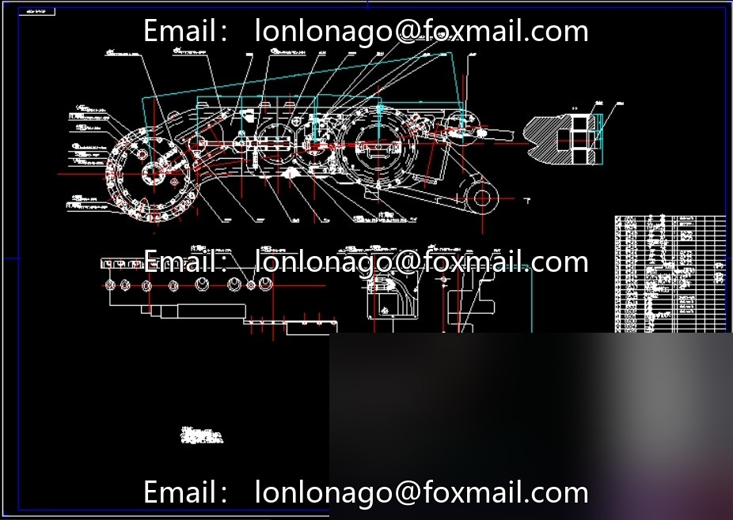
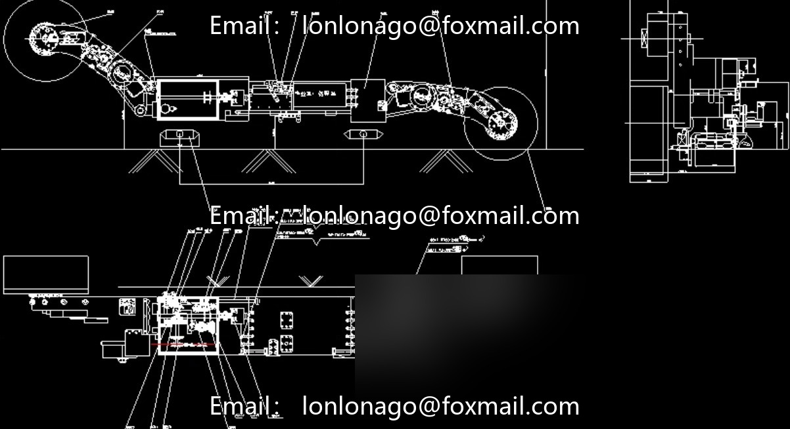
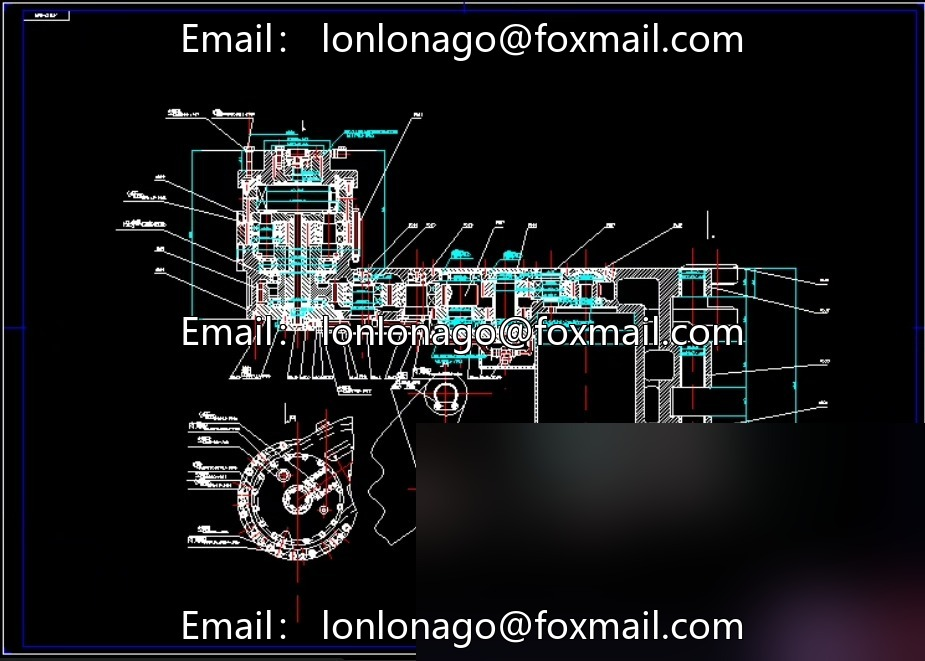
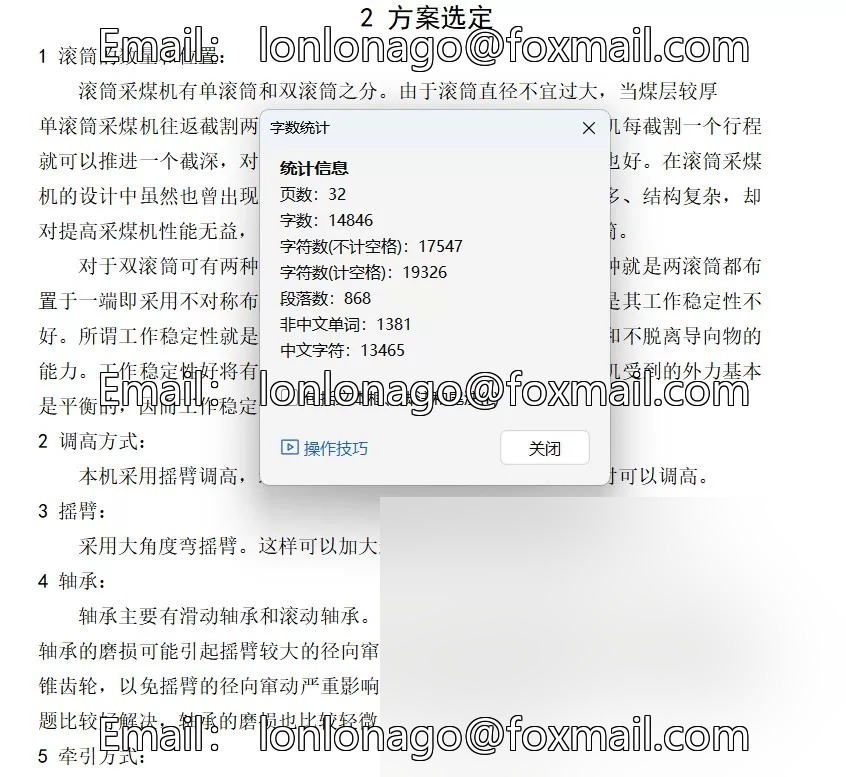

# Driving machine cutting section design, rock-cutting machine driving section design, rock-cutting machine driving section design CA

## Body

Working-face cutter design; roller working-face cutter design; working-face cutter design CAD drawings; this material contains CAD drawings plus other listed contents, see the figure below.
531

The material covers design of the coal cutter section, CAD drawings and related instructions, along with attached figures and files.

<!-- AI_ENRICHED -->

## Images

## Payment

Here is a pay link on Stripe ( https://buy.stripe.com/3cs8yP7sY87d0vu9AB ). Please contact me lonlonago@foxmail.com after funding $89, and I will send you a complete data files , thank you!

